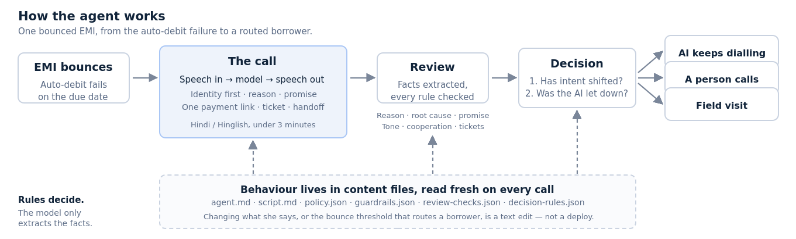
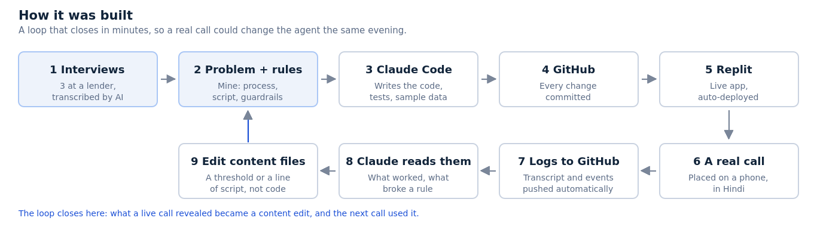

# AI build log

**Razorpay Trusted Collections Agent** — how the build was done, what the AI did, and where I made the calls.

Ujjwal Goel · 68 commits, 5–13 Oct 2026 (45 Claude Code, 13 Replit agent, 10 me) · about 11,800 lines of TypeScript, 8,400 lines of rules and content, 37 tests · [repository](https://github.com/mainujjwal26-ship-it/razorpay_buildathon) · [one-page product note](note/product-note.pdf)

---

## 1. AI tools and models used

| Tool or model | What it was used for | Build-time or runtime |
|---|---|---|
| Claude Code (Opus and Sonnet) | Wrote the application code, the tests, the sample book and the rule harness; ran the research sweeps | Build-time |
| Claude Sonnet, via API | Runs inside the product: drives each turn of the call, then reviews it and scores it against the rules | Runtime |
| Sarvam AI | Hindi and Hinglish speech to text and text to speech on the live call | Runtime |
| Replit + GitHub | Hosting and deployment; its agent worked the same repository | Build-time |
| Wispr Flow | Transcribed and summarised the three lender interviews | Build-time |

The distinction that matters: one set of tools *built* the product, and a different set *runs inside* it. The agent a borrower speaks to is a Claude model with Sarvam speech on either side; the thing that wrote it is Claude Code.

### How AI helped me 10x

- **Breadth one person could not cover.** A Hindi voice agent, a call review step, a decision engine, a six-tab dashboard and a planning tab, built in nine days: 68 commits, about 11,800 lines of code and 37 tests.
- **Research in hours.** AI scored the candidate problems against my criteria and researched the market size, the bounce data and the RBI recovery directions.
- **A feedback loop that closed in minutes.** Real call logs go to GitHub, Claude Code reads what happened, I edit a script line or a threshold, and the live app has it the same evening.

---

## 2. Key prompts, workflows and agent setup

The product is three layers: **the calling bot** that makes the call, **the call review bot** that reads it afterwards, and **the bot that recommends an action plan** from what the calls revealed. Between them sit written instructions, two prompts that return JSON, and a rule engine the model is not allowed to overrule. The instructions are all in the repository and can be read directly — these are the files that decide what the agent says and when it hands a borrower over.

| File | What it governs |
|---|---|
| [`content/prompts/agent.md`](content/prompts/agent.md) | How Meera speaks: her role, her limits, and the JSON she must return |
| [`content/script.md`](content/script.md) | The call itself: opening, identity check, how to ask for a promise, how to close |
| [`content/policy.json`](content/policy.json) | What she may offer: minimum part payment, link rules, calling hours |
| [`content/guardrails.json`](content/guardrails.json) | The never-do rules: no false promise, no threat, lender facts only |
| [`content/review-checks.json`](content/review-checks.json) | What the reviewer scores after the call, hard rules and judgement rules |
| [`content/decision-rules.json`](content/decision-rules.json) | The thresholds that route a borrower: bounces, promises kept, cooperation |
| [`content/customers/history.json`](content/customers/history.json) | The borrower history the decision reads: EMIs, promises, calls answered |

Two prompts do the work, and both return JSON rather than prose. The **turn prompt** takes the call so far and returns what to say, what to speak aloud, which action to take (one payment link, raise a ticket, hand off) and whether to end the call. The **review prompt** takes the finished transcript and returns the outcome, the reason, the root cause, the promise, the borrower's cooperation and a verdict on every rule. Structured output is what lets the rest of the system be ordinary, testable code — and it is why the model never picks the route.

*The three layers: the call, the review of the call, and the plan. The rules, not the model, decide what happens next.*

**Reading it across:** the borrower's audio goes to the server, which sends it to Sarvam for transcription, builds the turn prompt from the content files, and calls the Claude API for a structured turn; speech goes back out through Sarvam. Every event is written to Postgres and the call log is pushed to GitHub. When the call ends, the review prompt and the checks written in code score the same call independently, and a flag from either counts. Only then does the decision engine combine those facts with the borrower's history and pick a route. The third layer does not stop at one borrower: the Plan tab turns every route into a plan for the cycle — how many AI calls, person calls and reminders, how much money lands by day 1, 3 and 7, and whether the gap to target sits in the agent, in our callers or in where effort goes.

The build loop mattered as much as the prompts. Claude was connected to GitHub, and GitHub to Replit, so a change was live in minutes. Call logs are pushed back into the same repository, so Claude Code could read what actually happened on a real call — what the borrower said, which rule tripped, where the agent stalled — instead of me listening to recordings and writing notes. Every change passed typecheck, build, 37 tests and a screenshot of the real screen before it was committed.

*The build loop: a live call could change the agent the same evening.*

---

## 3. One AI output I rejected, corrected or significantly improved

**The suggestion: let the model judge everything.** When I specified how the agent's calls would be scored, the AI proposed the simplest design: give the model the transcript and let it judge every rule, hard and soft. It would have been less code and it read well in a demo.

**Why I rejected it.** A lender cannot audit a verdict it cannot explain. If a model alone says a call broke a rule, nobody can show the regulator why, and nobody can tell whether the model or the agent was wrong.

**What I did instead.** The hard rules (one payment link, no threat, nothing the lender has not approved) are checked in exact code. The judgement rules (did she listen first, did she handle the reason) are scored by the model, but each verdict must cite a quote from the call. A flag from either side counts as a breach. Every verdict can be traced to a line of code or a line of the transcript.

Also rejected: a demo mode on its own interface. It now runs the real screens with canned data.

---

## 4. What the AI did versus what I decided and built

| What I decided and defined | What the AI did |
|---|---|
| Chose the problem: brainstormed broadly, then set my own selection criteria and stress-tested each candidate against them before committing to post-bounce collections. | Scored the candidates against my criteria, argued the weak ones down, and researched the market size, the bounce data and the RBI recovery directions. |
| Defined the collections process itself — buckets, the post-bounce workflow, what a good agent does — from my own years in the domain, then corrected it against three lender interviews I ran. | Turned that process into a working call flow, state machine and data model, and transcribed and summarised the interviews. |
| Wrote the inputs that govern behaviour: the guardrails, the rule checks that count as a breach, the tonality and the call script. | Implemented each rule twice — as exact code and as an AI reviewer — so a flag from either counts, and built the harness that scores every call. |
| Set the decision design: rules decide the route, the model only extracts facts. Hard rules in code, judgement rules scored by the model, so every verdict can be explained. One persona with real history rather than six shallow ones. | Built the decision engine and the tests that pin its thresholds, and implemented the hard and judgement rules as I specified them. |
| Specified the dashboard: which tabs exist, what each one answers, and who each is for. Decided the product must end in a plan, not a recommendation, and what the gap areas are: the agent, our callers, and where effort goes. | Built the screens and the Plan tab, computed the metrics across a 100-call sample book, and rebuilt them when I changed the structure. |
| Judged every output: what shipped, what was cut, and what was wrong. | Produced far more than shipped, which is what made cutting cheap. |

The honest summary: the AI was a computational assistant. It did the heavy lifting — code, computation, research, sample data — and sharpened what I knew by arguing with it. The problem, the collections process, the guardrails and what each screen answers came from my own time in this domain and the three interviews.

### What I deliberately left out

These were scoping decisions, not things the AI could not build. The reasons are in the [product note](note/product-note.pdf).

- **Pre-bounce awareness calling.** Making a borrower aware in time can be done by an IVR call or a reminder. The talking, and the intent worth capturing, happens after the bounce, so that is where we started.
- **One playbook for every lender.** Each bank or NBFC sets up its own agent, so the demo journey is a sample. The product is the layer beneath any agent: better signals and the next step, not just another collections bot.

---

## 5. Known limitations, risks and verification steps

- **The numbers are synthetic.** Every metric on the performance screens comes from a 100-call sample book, not from live borrowers. They show the measurement works, not that the agent works.
- **The weights are uncalibrated.** Nothing yet records whether a promise was kept, so the confidence walk behind the decision has never been checked against a real outcome. Until it is, the thresholds are reasoned, not proven.
- **The plan is shown, not executed.** The Plan tab says what to do this cycle, but nothing yet dials, hands a case over or sends a reminder, and the sample holds no results for person calls, so none are assumed.
- **The AI reviewer is untuned.** The 29.7% hard-rule breach rate on sample calls is partly a strict reviewer and partly the agent being wrong; I cannot yet separate the two.
- **How it was verified.** Rules are checked twice, by exact code and by the model, and a flag from either counts. 37 tests pin the thresholds and the metric arithmetic, and screens were checked by screenshot. Every figure in the note has a source or is labelled my own calculation, because the AI once wrote a statistic that was not in the data.
